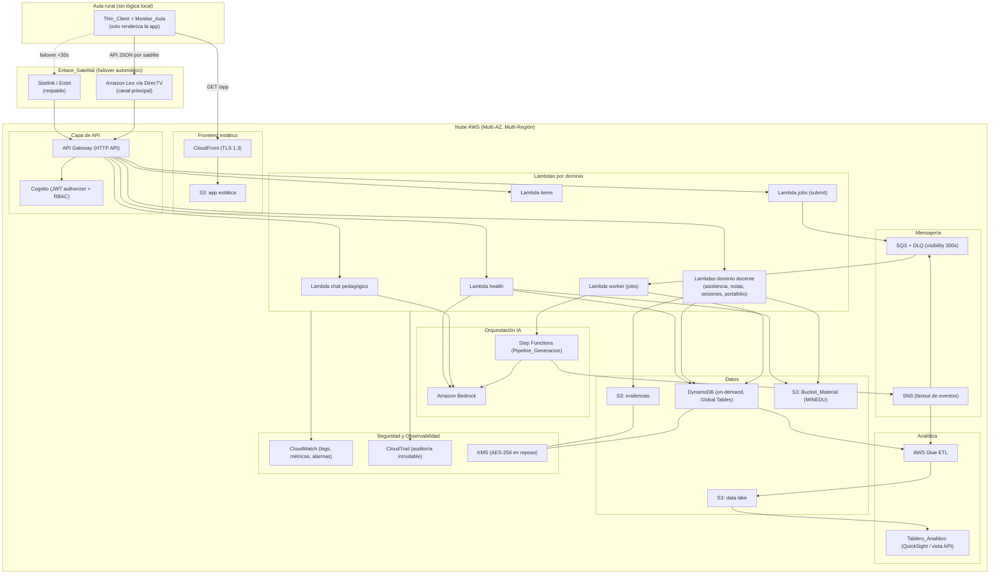
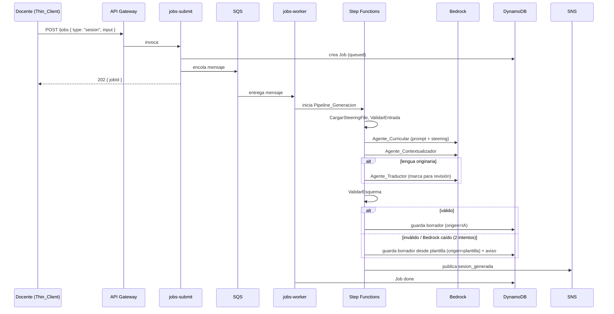
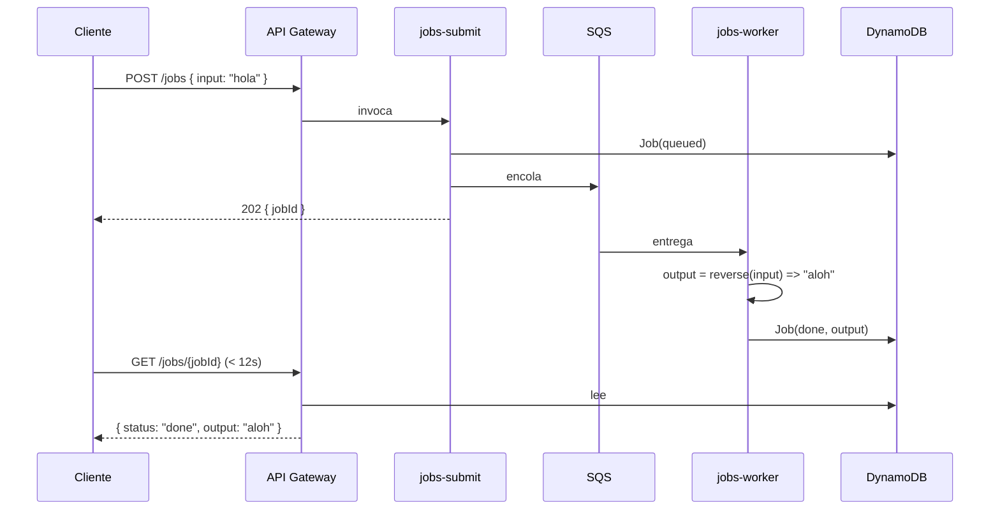
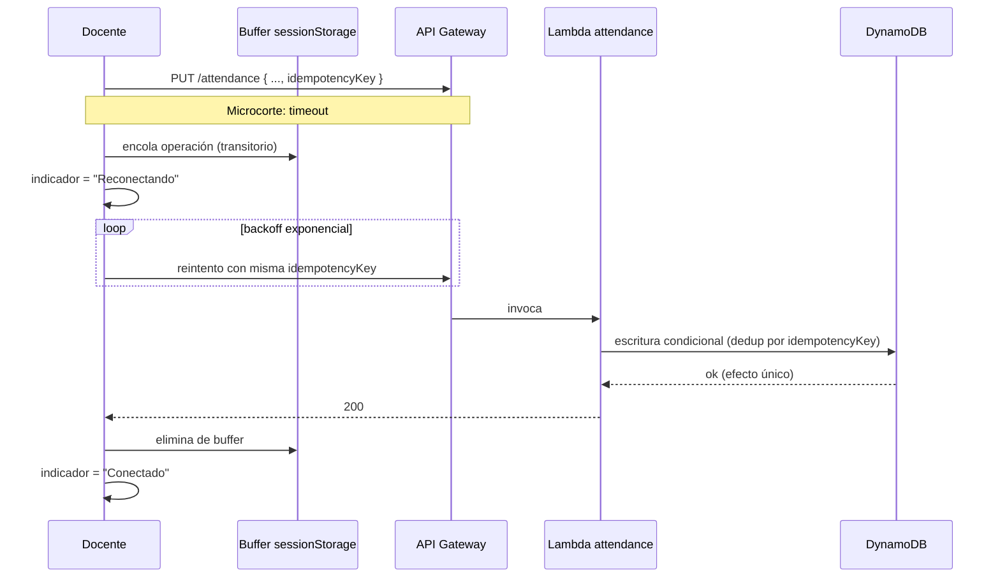
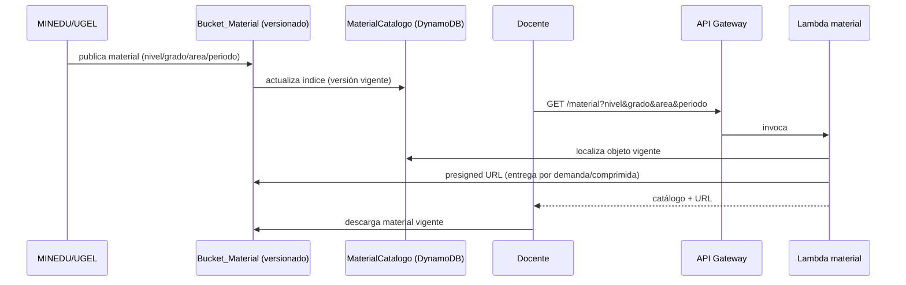

# Design Document

## Overview

El **Copiloto Docente Rural e Híbrido** es un sistema EdTech *cloud-first* desplegado íntegramente sobre servicios de AWS, diseñado para operar en escuelas públicas rurales del Perú conectadas por `Enlace_Satelital` (Amazon Leo vía DirecTV como canal principal, Starlink/Entel como respaldo). Este documento describe la arquitectura técnica que satisface los 26 requisitos consolidados en `requirements.md`, con énfasis en tres contratos no negociables:

1. **Arquitectura cloud-first, serverless y de bajo costo** (Principios 1-3, Req. 22, 23): toda la lógica, datos y modelos residen en la nube; el aula usa `Thin_Client` que solo renderiza la app. Se priorizan servicios de pago por uso (Lambda, DynamoDB on-demand, S3, SQS, SNS, Step Functions, Bedrock).
2. **Contrato de API del hackathon** (Req. 20, 25): rutas públicas `/health`, `/items`, `/jobs`, `/app` verificables de forma automática, más el panel docente autenticado con Cognito.
3. **GenAI con propósito** (Req. 5-8, 11, 12, 17, 21): generación de sesiones y chat pedagógico mediante Amazon Bedrock orquestado con Step Functions, con prompts diseñados, validación de esquema, reintento y *fallback* a plantilla.

El diseño mantiene trazabilidad explícita a los requisitos: cada componente y propiedad referencia el número de requisito que satisface. La estrategia transversal frente a `Microcorte` (decisión diferida a diseño) se define aquí en la sección "Estrategia de Microcortes": reintento con *backoff* exponencial, idempotencia por clave, buffer transitorio en el navegador (nunca base de datos local) y *failover* de enlace a nivel de red. **No existe operación offline por días ni base de datos local**, porque el factor limitante es la energía eléctrica, no el enlace.

### Decisiones de diseño y su justificación

- **Serverless por defecto (Req. 22.3, 22.8):** Lambda + DynamoDB on-demand escalan a 5000 aulas concurrentes sin servidores siempre encendidos, alineando el TCO al presupuesto del sector público.
- **Jobs asíncronos unificados (Req. 6, 20.5-20.7):** el mismo mecanismo `POST /jobs` + SQS + worker sirve tanto para el caso del verificador del hackathon (invertir cadena) como para la generación de sesiones con Bedrock (job `type: "sesion"`). Un solo contrato, dos cargas de trabajo.
- **Step Functions para IA multi-agente (Req. 5, 17):** orquestación trazable, recuperable e idempotente con compensación por paso, superior a encadenar Lambdas manualmente.
- **Separación público/autenticado en API Gateway (Req. 4, 20):** las rutas del contrato del hackathon son públicas; el panel docente exige JWT de Cognito con RBAC.

## Architecture

### Visión general cloud-first



### Capas de la arquitectura

| Capa | Servicios AWS | Requisitos |
|------|---------------|------------|
| Cliente | Thin_Client (navegador, ≥2 GB RAM), Monitor_Aula | 22.9, 24.1-24.3 |
| Red | Enlace_Satelital (Amazon Leo vía DirecTV / Starlink Entel), *failover* <30s | 1.1-1.2, 22.10 |
| Frontend | S3 (app estática) + CloudFront, TLS 1.3 | 20.8, 22.1 |
| API | API Gateway (HTTP API) + Lambda; Cognito JWT authorizer | 4, 20, 25 |
| Datos | DynamoDB (on-demand, Global Tables, Auto Scaling) + S3 | 3, 13, 22.4-22.5, 26 |
| IA | Bedrock + Step Functions (Pipeline_Generacion) | 5-8, 11, 12, 17 |
| Mensajería | SNS (fanout) + SQS (DLQ, visibility 300s) | 19 |
| Analítica | Glue ETL + data lake S3 + Tablero_Analitico | 18 |
| Seguridad/Obs. | Cognito, KMS, CloudTrail, CloudWatch | 4, 22.1-22.2, 25 |

### Patrón de despliegue Multi-AZ y Multi-Región (Req. 22.4, 22.6)

Lambda, API Gateway y S3 son regionales y multi-AZ por diseño. DynamoDB se configura con **Global Tables** replicando en al menos 2 regiones (p. ej. `us-east-1` y `sa-east-1` por cercanía y cumplimiento). El Auto Scaling on-demand absorbe picos >10 000 escrituras/s sin degradar latencia.

## Components and Interfaces

### 1. Frontend estático (S3 + CloudFront) — Req. 20.8, 3.2

App web SPA empaquetada como artefactos estáticos en un bucket S3 privado, expuesta solo a través de CloudFront con OAC (Origin Access Control). La ruta `GET /app` devuelve el HTML público sin autenticación ni redirección. El cliente implementa:

- Indicador de estado de conexión `Conectado` / `Reconectando` / `Sin enlace` (Req. 2).
- Cola de reintento transitoria en memoria/`sessionStorage` (buffer, no base de datos) (Req. 1.4, 9.2, 10.2).
- Compresión y envío por lotes de operaciones (Req. 23.1-23.3).

### 2. API Gateway (HTTP API) — Req. 20, 25

Un único HTTP API con dos clases de rutas:

- **Públicas (contrato hackathon):** `/health`, `/health/{componente}`, `/items`, `/items/{id}`, `/jobs`, `/jobs/{jobId}`, `/app`. Sin authorizer.
- **Autenticadas (panel docente):** `/sessions`, `/attendance`, `/grades`, `/portfolio`, `/chat`, `/curriculum`, `/review`, `/material`, `/dashboard`. Protegidas por un **JWT authorizer de Cognito** que valida el token y las claims de rol (RBAC).

### 3. Amazon Cognito — Req. 4, 22.2

User Pool con grupos `docente`, `curador`, `administrador_UGEL`. El `cognito:groups` claim alimenta el RBAC en cada Lambda. Política de bloqueo: 5 intentos fallidos → bloqueo 15 min + evento en log de seguridad (Req. 4.4), implementado con un Lambda trigger `PreAuthentication`/`PostAuthentication` que cuenta intentos en DynamoDB.

### 4. Lambdas por dominio

| Lambda | Responsabilidad | Requisitos |
|--------|-----------------|------------|
| `health` | Ejecuta health checks por componente y calcula estado global | 25 |
| `items` | CRUD público de items | 20.2-20.4 |
| `jobs-submit` | Crea job, encola en SQS, responde 202 con `jobId` | 6.1, 20.5, 25.9 |
| `jobs-worker` | Consume SQS, procesa (invertir cadena o lanzar Pipeline_Generacion), escribe resultado en DynamoDB | 20.6-20.7, 6 |
| `jobs-get` | Lee estado/output de DynamoDB | 20.6 |
| `attendance` | Registra y consulta asistencia (idempotente) | 9 |
| `grades` | Registra calificaciones y reportes | 10 |
| `sessions` | Guarda/lista/edita sesiones, maneja estados | 5.5, 5.7, 14 |
| `portfolio` | Carga evidencias a S3, metadatos, marca "completo" | 13 |
| `chat` | Chat pedagógico con Bedrock | 11 |
| `curriculum` | Programación curricular y Steering_File | 3, 16 |
| `review` | Flujo de curaduría (validar/rechazar/escalar) | 15 |
| `material` | Catálogo e índice del Bucket_Material | 26 |

Cada Lambda escribe logs estructurados y métricas a CloudWatch y eventos de auditoría a CloudTrail/tabla append-only.

### 5. Orquestación IA: Step Functions + Bedrock (Pipeline_Generacion) — Req. 5, 17

El `Pipeline_Generacion` es una máquina de estados de Step Functions que ejecuta los pasos en orden (Req. 17.1):

1. `CargarSteeringFile` → lee config declarativa de S3/DynamoDB (Req. 5.8, 17.7).
2. `ValidarEntrada` → rechaza tema vacío (Req. 6.5).
3. `AgenteCurricular` → invoca Bedrock con prompt curricular (Req. 5.2, 6.2, 6.3).
4. `AgenteContextualizador` → adapta al contexto rural del Steering_File (Req. 5.4).
5. `AgenteTraductor` (condicional) → traduce a `Lengua_Originaria` y marca consignas para revisión (Req. 5.3, 6.4, 8).
6. `FormateoMINEDU` → estructura la `Sesion_Aprendizaje`.
7. `ValidarEsquema` → valida la respuesta contra el esquema de `Sesion_Aprendizaje` (Req. 7.1).
8. `AlmacenarBorrador` → guarda borrador en DynamoDB (Req. 5.5).
9. `PublicarEvento` → publica `sesion_generada` en SNS (Req. 19.1).

**Agentes de IA como pasos/funciones.** Cada agente (`Orquestador_Agentes`, `Agente_Curricular`, `Agente_Contextualizador`, `Agente_Traductor`, `Agente_Portafolio`) se implementa como un estado `Task` que invoca una Lambda delgada; esa Lambda construye el prompt a partir del `Steering_File` (lengua, zona, grado, área) e invoca Bedrock (Converse API). El `Steering_File` **condiciona el prompt**: inyecta glosario, restricciones culturales y contexto comunitario. Los Steering_File se almacenan como objetos versionados en S3 (texto declarativo) con un índice en DynamoDB para recarga en caliente sin reiniciar (Req. 17.7).

**Manejo de errores y fallback (Req. 5.6, 5.9, 7.2-7.3, 17.2-17.3):**
- Reintento de cada `Skill` hasta 2 veces (`Retry` con *backoff*).
- Si la respuesta es inválida frente al esquema → reintento de la generación 1 vez.
- Si el segundo intento falla o Bedrock no está disponible → estado `FallbackPlantilla` que produce un borrador desde una plantilla servida de S3 y marca aviso al docente.
- `Catch` global → compensa pasos previos de forma idempotente y notifica a CloudWatch.

### 6. Chat pedagógico (Bedrock) — Req. 11

Lambda `chat` que invoca Bedrock con un prompt diseñado que inyecta contexto del Currículo Nacional MINEDU. Si el enlace/Bedrock no está disponible, responde con un aviso de servicio temporalmente no disponible (Req. 11.3).

### 7. Mensajería: SNS + SQS — Req. 19

- **SNS:** topics `notificaciones` y `revisiones`; *fanout* de `sesion_generada`, `sesion_revisada` y actualización de `Steering_File` hacia colas SQS suscritas, Tablero_Analitico, notificaciones de curadores y log de auditoría (Req. 19.1-19.2, 19.5-19.6).
- **SQS:** entrega *at-least-once*, `visibility timeout` 300s (Req. 19.3, 19.7); tras >3 intentos el mensaje va a la **DLQ** y se registra en auditoría (Req. 19.4).

### 8. Analítica: Glue + data lake + Tablero_Analitico — Req. 18

Step Functions dispara un ETL de Glue que valida integridad y carga datos al data lake en S3; registros con inconsistencia referencial se aíslan y el resto continúa (Req. 18.1, 18.5). El `Tablero_Analitico` (QuickSight sobre el data lake, o una vista servida por la API) muestra sesiones por escuela, tasa de validación por curador, portafolios completados y métricas por escuela/UGEL, con filtros y refresco <5 min (Req. 18.2-18.4).

### 9. Observabilidad y seguridad transversales — Req. 22, 25

CloudWatch concentra logs, métricas y alarmas ligadas a los health checks. CloudTrail provee auditoría; el log de auditoría inmutable se refuerza con una tabla DynamoDB append-only y/o S3 Object Lock (WORM). Cifrado AES-256 en reposo vía SSE-S3/KMS y DynamoDB encryption; TLS 1.3 en tránsito (Req. 22.1). Cumplimiento Ley 29733.

### Contrato de API del hackathon (diseño concreto)

#### `GET /health` y `GET /health/{componente}` — Req. 20.1, 25

La Lambda `health` ejecuta verificaciones por componente en paralelo:

- **Enlace_Satelital:** reporta canal activo (`leo`/`starlink`) y latencia; un `Microcorte` o pérdida temporal ⇒ `degraded`, **nunca** `unhealthy` (Req. 25.5-25.6).
- **DynamoDB:** alcanzable / no alcanzable.
- **Bedrock:** alcanzable / no alcanzable / degradado.
- **S3:** disponible / no disponible.
- **Endpoints API:** estado.

Cálculo del estado global:
- Todos sanos ⇒ `200` `healthy`.
- Al menos un componente **no esencial** degradado y sistema operativo ⇒ `207` `degraded`.
- Al menos un componente **esencial** caído ⇒ `503` `unhealthy`.

Respuesta incluye `timestamp`, `version` y `team`. Ejemplo:

```json
{
  "status": "ok",
  "team": "<teamId>",
  "global": "healthy",
  "version": "1.0.0",
  "timestamp": "2025-01-01T12:00:00Z",
  "checks": [
    { "component": "enlace_satelital", "status": "healthy", "message": "canal activo: leo, latencia 220ms" },
    { "component": "dynamodb", "status": "healthy", "message": "alcanzable" },
    { "component": "bedrock", "status": "healthy", "message": "alcanzable" },
    { "component": "s3", "status": "healthy", "message": "disponible" },
    { "component": "api", "status": "healthy", "message": "endpoints operativos" }
  ]
}
```

`GET /health/{componente}` devuelve solo el `check` del componente indicado (Req. 25.7).

> Nota: el campo `status: "ok"` se mantiene siempre que el servicio responde (contrato Req. 20.1), mientras que `global` expresa `healthy`/`degraded`/`unhealthy` (Req. 25).

#### `POST /items` / `GET /items/{id}` / `GET /items` — Req. 20.2-20.4

- `POST /items { value }` → persiste en DynamoDB tabla `Items`, responde `201 { id }` (Req. 25.8).
- `GET /items/{id}` → `{ value }`.
- `GET /items` → lista con el `nonce` persistido. Todas públicas.

#### `POST /jobs` / `GET /jobs/{jobId}` — Req. 20.5-20.7, 6

- `POST /jobs { input }` → `jobs-submit` crea el registro `Jobs` con `status: "queued"`, encola en SQS y responde **de inmediato** `202 { jobId }` con la ruta de consulta (Req. 25.9).
- `jobs-worker` consume SQS: para `type: "verificador"` produce `output = input` invertido como cadena; para `type: "sesion"` lanza el `Pipeline_Generacion` con Bedrock. Deja el resultado en DynamoDB en **< 12 s**.
- `GET /jobs/{jobId}` → `{ status: "done", output }` leyendo de DynamoDB. Públicas.

El mismo mecanismo asíncrono (SQS + worker + DynamoDB) sirve el caso del verificador y la generación de sesiones; solo cambia el `type` del job.

## Data Models

### Tablas DynamoDB

Todas on-demand, cifradas con KMS, con Global Tables en ≥2 regiones.

| Tabla | Partition Key (PK) | Sort Key (SK) | GSI | Propósito / Req. |
|-------|--------------------|---------------|-----|------------------|
| `Perfiles` | `userId` | — | `GSI1: escuelaId` | Perfil docente + steering (Req. 4, 16) |
| `Sesiones` | `docenteId` | `sesionId` | `GSI1: estado`, `GSI2: curadorId` | Sesiones y estados (Req. 5, 14, 15) |
| `SesionVersiones` | `sesionId` | `version#<n>` | — | Historial de versiones (Req. 15.4) |
| `Asistencia` | `aulaId` | `fecha#estudianteId` | `GSI1: estudianteId` | Asistencia (Req. 9) |
| `Calificaciones` | `aulaId` | `competencia#estudianteId` | `GSI1: estudianteId` | Notas (Req. 10) |
| `Portafolios` | `docenteId` | `periodo#sesionId` | — | Portafolio y estado completo (Req. 13) |
| `Evidencias` | `sesionId` | `evidenciaId` | — | Metadatos de evidencias (Req. 13) |
| `Items` | `id` | — | — | Contrato hackathon (Req. 20.2-20.4) |
| `Jobs` | `jobId` | — | `GSI1: status` | Jobs asíncronos (Req. 6, 20.5-20.7) |
| `Auditoria` | `fecha` | `ts#eventoId` | — | Log append-only inmutable (Req. 22.2) |
| `SteeringIndex` | `steeringId` | `version` | `GSI1: lengua#zona#grado#area` | Índice de Steering_File (Req. 5.8, 16) |
| `MaterialCatalogo` | `nivel#grado` | `area#periodo#materialId` | — | Catálogo de Bucket_Material (Req. 26.7) |

### Esquemas JSON

**Perfil de docente** (Req. 4, 16):
```json
{
  "userId": "u-123",
  "nombre": "Ana Quispe",
  "rol": "docente",
  "escuelaId": "esc-45",
  "aulas": ["aula-3A"],
  "steering": {
    "lengua_originaria": "quechua_sureno",
    "zona": "comunidad andina alto-andina",
    "grado": ["3", "4"],
    "area": ["comunicacion", "matematica"]
  }
}
```

**Sesion_Aprendizaje** (esquema usado para validar respuestas de Bedrock — Req. 5.2, 6.2, 7.1):
```json
{
  "sesionId": "ses-001",
  "docenteId": "u-123",
  "titulo": "string",
  "proposito": "string",
  "competencias": ["string"],
  "capacidades": ["string"],
  "desempenos": ["string"],
  "momentos": {
    "inicio": "string",
    "desarrollo": "string",
    "cierre": "string"
  },
  "materiales": ["string"],
  "evaluacion": { "criterios": ["string"] },
  "lengua": "castellano | quechua_sureno | ...",
  "bilingue": true,
  "actividadesPorGrado": [{ "grado": "3", "actividades": ["string"] }],
  "estado": "borrador | validada | rechazada",
  "origen": "IA | plantilla",
  "version": 1
}
```
El `ValidarEsquema` del pipeline rechaza respuestas de Bedrock que no cumplan tipos y campos obligatorios (`titulo`, `proposito`, `competencias`, `momentos`, `evaluacion`).

**Asistencia** (Req. 9.1):
```json
{ "aulaId": "aula-3A", "fecha": "2025-03-10", "estudianteId": "e-1",
  "estado": "presente | ausente | tardanza | justificado", "idempotencyKey": "..." }
```

**Calificacion** (Req. 10.1):
```json
{ "aulaId": "aula-3A", "estudianteId": "e-1", "competencia": "comunicacion-c1",
  "valor": "AD | A | B | C | <0-20>", "escala": "letras | vigesimal", "idempotencyKey": "..." }
```

**Evidencia** (Req. 13):
```json
{ "sesionId": "ses-001", "evidenciaId": "ev-9", "s3KeyOriginal": "...",
  "s3KeyComprimida": "...", "formato": "jpg|png|heic", "bytes": 1234567,
  "fecha": "...", "hora": "...", "geo": { "lat": 0, "lon": 0 } }
```

**Job** (Req. 6, 20.5-20.7):
```json
{ "jobId": "job-abc", "type": "verificador | sesion", "status": "queued | processing | done | failed",
  "input": "hola", "output": "aloh", "createdAt": "...", "updatedAt": "..." }
```

### Organización de buckets S3

| Bucket | Estructura | Req. |
|--------|-----------|------|
| App estática | `/` artefactos SPA, servido por CloudFront | 20.8 |
| Evidencias | `escuela/{id}/sesion/{id}/original|comprimida/` | 13.3-13.4 |
| `Bucket_Material` (MINEDU) | `nivel/{n}/grado/{g}/area/{a}/periodo/{p}/{materialId}` con **versionado** y SSE-KMS | 26.1-26.5 |
| Data lake | `raw/ curated/ analytics/` para Glue ETL | 18.1 |

Material de gran tamaño se entrega comprimido o por demanda (Req. 26.6); un índice en `MaterialCatalogo` permite localizar el objeto vigente (Req. 26.7).

## Estrategia de Microcortes

Decisión concreta (diferida desde requisitos, Req. 1.4, 2, 9.2, 10.2, 23):

1. **Reintento con backoff exponencial en el cliente:** ante error de red/timeout, el cliente reintenta con *backoff* (p. ej. 0.5s, 1s, 2s, 4s) durante la ventana del microcorte.
2. **Idempotencia por clave:** toda escritura a la API incluye una `idempotencyKey`; la API deduplica usando escritura condicional en DynamoDB, de modo que N reintentos producen un único efecto.
3. **Buffer de reintento transitorio en el navegador:** las operaciones pendientes se guardan en memoria/`sessionStorage` **solo como buffer de reintento** mientras dura el microcorte. **No es una base de datos local ni habilita operación offline por días.**
4. **Indicador de estado:** `Conectado` (enlace estable), `Reconectando` (microcorte + reintento en curso), `Sin enlace` (sin señal sostenida) (Req. 2).
5. **Failover de enlace a nivel de red:** la conmutación Leo↔Starlink ocurre en la capa de red (<30s, Req. 22.10), transparente para la app.
6. **/health refleja microcorte como `degraded`**, nunca `unhealthy` (Req. 25.6).

## Key Flows

### (a) Generación de sesión con IA multi-agente (Step Functions + Bedrock + fallback)



### (b) POST /jobs asíncrono (verificador) con SQS + worker



### (c) Registro de asistencia/calificación con reintento ante microcorte



### (d) Publicación y consumo de Material MINEDU en S3



## Criterios de Evaluación (Maestría Kiro y GenAI con propósito)

Alineado a Req. 21:

- **Steering file:** el repositorio incluirá al menos un archivo de steering (≥200 caracteres) que documente la configuración declarativa por lengua/zona/grado/área que condiciona los prompts de los agentes (Req. 21.2).
- **Hook:** el repositorio incluirá al menos un hook con condición `when` y acción `then` (p. ej. validar el esquema de `Sesion_Aprendizaje` al guardar) (Req. 21.3).
- **GenAI con propósito:** Bedrock se integra en flujos centrales (generación de sesiones y chat pedagógico) con **prompts diseñados por flujo** y **manejo de errores** (reintento hasta 2 veces + validación de esquema + *fallback* a plantilla) (Req. 21.4-21.5).
- **Spec completa:** `requirements.md`, `design.md` y `tasks.md` en la misma carpeta, cada uno ≥300 caracteres (Req. 21.1).

## Error Handling

Estrategia transversal:

1. **Validación de esquema (Req. 7.1):** toda respuesta de Bedrock se valida contra el esquema de `Sesion_Aprendizaje`; entradas de API se validan en el borde (tema vacío ⇒ error junto al campo, Req. 6.5).
2. **Reintentos (Req. 5.9, 7.2):** Skills hasta 2 veces; generación completa 1 reintento adicional. Cliente con *backoff* exponencial.
3. **Fallback a plantilla (Req. 5.6, 7.3):** si falla el segundo intento o Bedrock no está disponible, se genera borrador desde plantilla S3 con aviso al docente.
4. **DLQ (Req. 19.4):** mensajes SQS fallidos tras >3 intentos van a la DLQ y se registran en auditoría.
5. **Compensación en Step Functions (Req. 17.2-17.3):** `Catch` global compensa pasos previos y la reanudación es idempotente.
6. **Aislamiento en ETL (Req. 18.5):** registros inconsistentes se aíslan; el resto continúa.
7. **Degradación de servicio (Req. 1.5, 11.3, 12.4):** sin enlace, el sistema avisa "servicio temporalmente no disponible" y reanuda al restablecerse.

### Observabilidad (Req. 25, 22)

CloudWatch recibe logs estructurados, métricas por paso/agente (Req. 17.5-17.6) y alarmas ligadas a cada verificación del `/health`. Las alarmas (p. ej. Bedrock degradado, DynamoDB no alcanzable, DLQ con mensajes) permiten diagnóstico por componente coherente con los estados `healthy`/`degraded`/`unhealthy`. CloudTrail + tabla append-only / S3 Object Lock garantizan el log de auditoría inmutable.

## Correctness Properties

*Una propiedad es una característica o comportamiento que debe cumplirse en todas las ejecuciones válidas del sistema — en esencia, un enunciado formal de lo que el sistema debe hacer. Las propiedades son el puente entre las especificaciones legibles por humanos y las garantías de correctitud verificables por máquina.*

Las siguientes propiedades se derivan de los criterios de aceptación clasificados como testeables en el prework. Aplican a la lógica propia del sistema (funciones puras o mockeables), no a servicios externos (Bedrock, failover de red) que se cubren con pruebas de integración.

### Property 1: El output de un job es siempre el input invertido

*Para toda* cadena de entrada `input` (incluyendo vacía, unicode y de gran longitud), al crear un job de tipo "verificador" y consultarlo cuando su estado es "done", el campo `output` debe ser exactamente `input` invertido como cadena.

**Validates: Requirements 20.6, 20.7**

### Property 2: Persistencia de items es un round-trip

*Para todo* valor `value`, si se persiste con `POST /items` obteniendo un `id`, entonces `GET /items/{id}` debe devolver un `value` igual al persistido, y `GET /items` debe incluir ese valor.

**Validates: Requirements 20.2, 20.3, 20.4**

### Property 3: Las escrituras son idempotentes ante reintentos

*Para toda* operación de escritura (asistencia o calificación) con una `idempotencyKey` dada y *para todo* número de reintentos N ≥ 1 de esa misma operación, el estado final de la `Base_Datos_Nube` debe contener un único registro con el efecto aplicado exactamente una vez.

**Validates: Requirements 1.4, 9.2, 10.2**

### Property 4: Invariante de portafolio completo

*Para toda* `Sesion_Aprendizaje` y *para todo* conjunto de `Evidencia` asociadas, el `Portafolio_Docente` se marca "completo" si y solo si la sesión está en estado "validada" y tiene 3 o más evidencias asociadas; en consecuencia, todo portafolio marcado "completo" tiene al menos 1 (de hecho ≥3) evidencia asociada.

**Validates: Requirements 13.5**

### Property 5: Un microcorte nunca produce estado "unhealthy"

*Para todo* vector de estados de componentes en el que el único componente afectado es el `Enlace_Satelital` por un `Microcorte` o pérdida temporal de señal (y los componentes esenciales están sanos), el estado global reportado por `/health` debe ser "degraded" con código HTTP 207, y nunca "unhealthy" ni 503.

**Validates: Requirements 25.6**

### Property 6: Coherencia del cálculo de estado global de /health

*Para todo* vector de estados de componentes, el estado global y el código HTTP deben cumplir: todos sanos ⇒ "healthy"/200; al menos un componente no esencial degradado con el sistema operativo ⇒ "degraded"/207; al menos un componente esencial caído ⇒ "unhealthy"/503.

**Validates: Requirements 25.1, 25.2, 25.3, 25.4**

### Property 7: Preservación de términos sin equivalente en traducción

*Para toda* lista de términos técnicos marcados como sin equivalente en la `Lengua_Originaria`, el contenido traducido producido por el `Agente_Traductor` debe preservar cada uno de esos términos en español con el prefijo marcador "ES:".

**Validates: Requirements 8.3**

### Property 8: Round-trip de compresión de cargas satelitales

*Para toda* carga útil transmitida por el `Enlace_Satelital`, descomprimir el resultado de comprimir la carga debe producir exactamente la carga original.

**Validates: Requirements 23.1**

## Testing Strategy

El sistema combina pruebas unitarias, de integración y basadas en propiedades. Las propiedades universales (lógica propia y determinista) se cubren con *property-based testing*; la interacción con servicios externos (Bedrock, SQS/SNS reales, failover de red, configuración de infraestructura) se cubre con integración y *smoke tests*.

### Pruebas basadas en propiedades (PBT)

- Librería recomendada: **fast-check** (TypeScript/Node) para las Lambdas, o **Hypothesis** si alguna lógica se implementa en Python. No se implementa PBT desde cero.
- Cada propiedad se implementa con **un único** test basado en propiedades, configurado con **mínimo 100 iteraciones**.
- Cada test referencia su propiedad de diseño con el formato de etiqueta:
  **Feature: copiloto-docente-rural, Property {número}: {texto de la propiedad}**
- Las invocaciones a Bedrock, DynamoDB, SQS y S3 se **mockean** en los tests de propiedades para aislar la lógica y mantener el costo bajo.

Mapeo propiedad → objetivo de prueba:

| Propiedad | Objetivo de prueba | Enfoque |
|-----------|--------------------|---------|
| 1 | Worker de jobs (invertir cadena) | PBT, generadores de cadenas unicode/vacías/largas |
| 2 | Persistencia de items (round-trip) | PBT con DynamoDB mock |
| 3 | Idempotencia de escrituras | PBT variando N reintentos e `idempotencyKey` |
| 4 | Invariante de portafolio | PBT variando estado y conteo de evidencias |
| 5 | /health microcorte = degraded | PBT sobre vectores de estado con enlace degradado |
| 6 | /health agregación global | PBT sobre todos los vectores de estado posibles |
| 7 | Marcador "ES:" en traducción | PBT sobre listas de términos sin equivalente |
| 8 | Round-trip de compresión | PBT sobre payloads arbitrarios |

### Pruebas unitarias (ejemplos y casos borde)

- `GET /health` responde 200 con campos `status: "ok"` y `team` presentes (Req. 20.1).
- Bloqueo de cuenta tras 5 intentos fallidos durante 15 min; 4 intentos no bloquean (Req. 4.4).
- `POST /jobs` responde 202 con `jobId` de inmediato (Req. 6.1, 20.5, 25.9); `POST /items` responde 201 con confirmación (Req. 25.8).
- Tema vacío al generar sesión ⇒ error junto al campo y rechazo (Req. 6.5).
- Validación de esquema de `Sesion_Aprendizaje` rechaza respuestas incompletas (Req. 7.1).
- Validación de formato/tamaño de evidencia (JPG/PNG/HEIC ≤10 MB) (Req. 13.2).

### Pruebas de integración

- Generación de sesión end-to-end con Bedrock mockeado: latencia dentro de ventana, *fallback* a plantilla cuando falla el segundo intento (Req. 5.1, 5.6, 7.3).
- Pipeline_Generacion en Step Functions: orden de pasos, compensación idempotente ante fallo (Req. 17.1-17.3).
- Fanout SNS → SQS y manejo de DLQ tras >3 intentos (Req. 19.4-19.6).
- ETL de Glue aísla registros inconsistentes y continúa (Req. 18.5).
- Jobs asíncronos: resultado disponible en < 12 s (Req. 20.7).

### Smoke y verificación de configuración

- SQS con `visibility timeout` 300s y DLQ configurada (Req. 19.7, 19.4).
- Cifrado en reposo (KMS/SSE) y TLS 1.3 habilitados (Req. 22.1).
- DynamoDB Global Tables en ≥2 regiones y Multi-AZ (Req. 22.4, 22.6).
- Failover Leo↔Starlink <30s (Req. 22.10) — prueba de red/infraestructura, no PBT.

---

He completado el documento de diseño para la feature **copiloto-docente-rural**, alineado 1:1 con los 26 requisitos. ¿Deseas que revise alguna sección o ajuste algún detalle antes de continuar con la fase de tareas?
